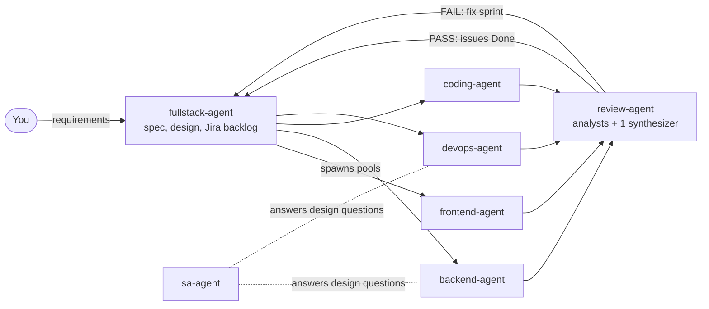

# Claude Code Multi-Agent Development Team

A sample [Claude Code](https://code.claude.com/docs/en/overview) configuration that turns one
session into a coordinated team of specialist AI agents. A lead agent writes the spec and a
Jira backlog; frontend, backend, infrastructure and general-purpose agents build in parallel,
each claiming its own issues from the board; reviewers check every change for correctness and
security before it is closed. Python hooks check the protocol at the moment an agent acts, and
every decision is logged.

The default target is a secure, serverless application on AWS: a Python backend (Lambda, API
Gateway, DynamoDB or Aurora), infrastructure in AWS CDK or SAM, and a React + TypeScript + Vite
frontend.

> **Disclaimer**: This repository is an example and is **not approved for production use**.
> The agent configurations, rules and workflows are starting points. Review and adapt them to
> your own requirements, conventions and security posture before use. Adoption requires your
> organisation's legal review: complete the [LLM Legal Approval](#llm-legal-approval) table
> first.

## Contents

- [The team](#the-team)
- [How it works](#how-it-works)
- [Safety model](#safety-model)
- [Prerequisites](#prerequisites)
- [Quick start](#quick-start)
- [Jira setup](#jira-setup)
- [Plugins and MCP servers](#plugins-and-mcp-servers)
- [Running a build](#running-a-build)
- [Reference](#reference)
- [Customisation](#customisation)
- [Legal, security and licence](#llm-legal-approval)

## The team

| Agent | Role | Model | Effort | Parallel instances |
|-------|------|-------|--------|--------------------|
| **fullstack-agent** | Team lead: research, spec and design, Jira backlog, spawns and coordinates the team. Writes no code | opus | xhigh | 1 |
| **frontend-agent** | React + TypeScript + Vite UI: accessible, responsive, checked in a real browser | sonnet | high | up to 3 |
| **backend-agent** | Python APIs and services on AWS serverless, built against a fixed API contract | sonnet | high | up to 3 |
| **coding-agent** | Everything else: scripts, glue code, tooling | sonnet | high | up to 6 |
| **devops-agent** | Infrastructure as code (CDK or SAM), CI/CD, deployment, runbooks. The only role allowed to change AWS | sonnet | xhigh | up to 2 |
| **review-agent** | Correctness, security (OWASP Top 10, IAM, secrets) and maintainability review; the only role besides the lead that closes issues | opus | max | up to 4 |
| **sa-agent** | AWS Solutions Architect: Well-Architected and security review, and the builders' consultant on AWS design questions | opus | high | 1 |

Pool sizes are ceilings, not quotas: the lead sizes each pool to the work available, and the
build pools together are capped at 8 concurrent agents.

## How it works



1. **Plan.** `fullstack-agent` turns your requirements into a spec (`spec.md`, `design.md`)
   under `.claude/specs/<slug>/`, then authors a Jira Epic and one issue per unit of work. Each
   issue carries a role tag, the files it may change, its acceptance criteria and the command
   that verifies it. Work is split into wide, file-disjoint groups so many agents can work at
   once. When a feature spans the UI and the API, the first issue fixes the API contract and
   both sides then build against it in parallel.
2. **Build.** The lead opens a sprint per group and spawns pools of specialists. Each agent
   claims an unclaimed issue for its role through an atomic lock, changes only that issue's
   files, verifies its work with `scripts/verify_issue.py`, and moves the issue to `In Review`.
   AWS questions of fact are answered from the AWS documentation and cited; design decisions
   the spec does not settle go to `sa-agent` (or the lead) and are recorded in the spec's
   `decisions.md`, never guessed.
3. **Review.** Reviewers check each change against the issue and the security guidelines. One
   synthesizer posts a single PASS/FAIL verdict per group and closes the passing issues.
4. **Fix.** A failed review becomes a fix sprint, and the loop repeats.
5. **Learn.** Reviewers and workers record lessons from their mistakes; every agent reads the
   lessons for its role before claiming work (see [Shared lessons](#shared-lessons)).

Agents coordinate through the Jira board (via the Atlassian MCP server) and direct messages.
The board is the record: open it to see who is doing what.

## Safety model

The hooks catch **mistakes**: a transition nobody verified, an edit to a file another agent
holds, an AWS change aimed at the wrong account, a guardrail file edited in passing. They make
the honest path the easy one and leave an audit trail. They are **not** the security boundary,
and are not built to stop an agent that sets out to get round them: a hook is a script reading
a tree the agent can write.

Enforcement is four things no agent can write. Set each up before an unattended run:

| Boundary | What it stops | How you set it up |
|----------|---------------|-------------------|
| **Bash sandbox** (`.claude/settings.json`) | Shell writes to hooks, settings, rules, the Jira mirror and operator records; reads of credentials; leaving the sandbox (`allowUnsandboxedCommands: false`) | Shipped. Keep broad allow rules (`Bash(python3 *)`, `Bash(curl *)`) and tokens out of `.claude/settings.local.json` |
| **GitHub** | Unreviewed or unverified code reaching `main`; an agent changing the harness or CI | Branch protection on `main` requiring the `ci` workflow and a review, and a `CODEOWNERS` entry making you the owner of `.claude/`, `.github/` and `scripts/harness_admin.py` |
| **Jira** | An agent account closing its own work | No "Transition to Done" permission for the agents' account, or a workflow condition restricting it to reviewers |
| **AWS credentials** | Changes outside the sandbox account | Credentials (an SSO role or profile) that exist only in the sandbox account. The AWS guard is the reminder; the account boundary is the control |

Until branch protection is in place, a passing board means "the agents say so".

Other safeguards:

- **AWS changes** are allowed only from the lead or a devops agent, with the region stated,
  inside the sandbox account you declare. Anything else stops and prints an approval id for
  you to approve from your own terminal.
- **Untrusted content.** Web pages, Jira text and tool output are treated as data, never as
  instructions (`.claude/rules/untrusted-content.md`), and a hook flags results that contain
  instruction-shaped text.
- **The harness protects itself.** Hooks, settings, agent definitions, rules and skills, the
  gate and capability configuration, CI workflows and the admin script can only be edited in a
  maintenance session you launch.

`SECURITY.md` has the full threat model.

## Prerequisites

- [Claude Code](https://code.claude.com/docs/en/overview)
- A Jira Cloud site and an Atlassian account (see [Jira setup](#jira-setup))
- `git`, and `python3` on `PATH` (the hooks use only the standard library)
- [uv](https://docs.astral.sh/uv/), which runs the AWS MCP servers
- AWS credentials, the AWS CLI, and the SAM CLI and/or AWS CDK for the default serverless stack
- [Node.js](https://nodejs.org/) 20.19+ or 22.12+ with `npm`/`npx`, for frontend work and the
  browser MCP servers. It must be on the `PATH` Claude Code starts with; a Node installed
  through `nvm` often is not
- *(Optional)* the GitHub CLI (`gh`) for pull requests
- *(Optional)* [tmux](https://github.com/tmux/tmux) or [iTerm2](https://iterm2.com/) for a
  split-pane view with one pane per agent. Without them agents run in-process, which works in
  any terminal

## Quick start

1. **Clone the repository and start Claude Code from its root.** The project's `.claude/`
   directory loads automatically:

   ```bash
   git clone https://github.com/<owner>/sample-claude-code-agent-team.git
   cd sample-claude-code-agent-team
   python3 -m venv .venv && .venv/bin/python -m pip install --no-input -r requirements-dev.txt
   claude
   ```

2. **Install the plugins.** `.claude/settings.json` enables 13 plugins from the official
   marketplace, `claude-plugins-official`. Claude Code installs them on the first start after
   the settings are in place. If they show as missing in `/plugins`, register the marketplace
   and restart:

   ```bash
   claude plugin marketplace add anthropics/claude-plugins-official
   ```

3. **Set up Jira** (one time): see [Jira setup](#jira-setup).

4. **Declare your AWS sandbox** from your own terminal, so the devops agent can deploy there
   without asking each time. Without it, every AWS change waits for your approval:

   ```bash
   python3 scripts/harness_admin.py sandbox --account 123456789012 --regions ap-southeast-2
   ```

5. **Run the preflight:**

   ```bash
   python3 scripts/doctor.py --profile serverless,frontend
   ```

   It exits 1 on any failure. Fix what it reports before an unattended run.

6. **Start building** with `/plan-it` (see [Running a build](#running-a-build)).

The agent-team feature is experimental in Claude Code; the shipped `settings.json` enables it
with `"CLAUDE_CODE_EXPERIMENTAL_AGENT_TEAMS": "1"`.

### Using the configuration in another project

Copy the configuration and the scripts the hooks rely on into the other project's root. Set
`SAMPLE_REPO` to where you cloned this repository, then run from the other project:

```bash
SAMPLE_REPO=/path/to/sample-claude-code-agent-team

mkdir -p .claude/lessons scripts
cp -r "$SAMPLE_REPO"/.claude/agents "$SAMPLE_REPO"/.claude/rules "$SAMPLE_REPO"/.claude/skills \
      "$SAMPLE_REPO"/.claude/hooks .claude/
cp "$SAMPLE_REPO"/.claude/settings.json "$SAMPLE_REPO"/.claude/gates.json \
   "$SAMPLE_REPO"/.claude/capabilities.json .claude/
cp "$SAMPLE_REPO"/.claude/lessons/README.md .claude/lessons/
mkdir -p .claude/commands && cp "$SAMPLE_REPO"/commands/*.md .claude/commands/
cp "$SAMPLE_REPO"/scripts/*.py scripts/
cp "$SAMPLE_REPO"/.gitattributes .
```

The copied `settings.json` resolves hooks through `$CLAUDE_PROJECT_DIR`, so no path edits are
needed. Then edit `.claude/gates.json` so its `agentChecks` run your project's own lint and
tests. Copying the configuration into `~/.claude/` for global use is not supported: the
verification gate needs `scripts/verify_issue.py` and `.claude/gates.json` in each project.

## Jira setup

The team tracks all work in Jira. Two credentials, split by privilege:

**Runtime.** Authenticate the Atlassian MCP server from inside Claude Code with `/mcp`. The
grant is `read:jira-work` and `write:jira-work`, which is all the agents need. It cannot
create a project or run the sprint lifecycle; that needs the admin credential.

**Admin.** Create a Jira API token at *id.atlassian.com > Security > API tokens*, then export
it **in a separate terminal from the one you start Claude Code in**:

```bash
export JIRA_SITE=your-site.atlassian.net
export JIRA_EMAIL=you@example.com
export JIRA_API_TOKEN=...
```

The separate terminal is the point. The token acts with your full Jira permissions, and every
command an agent runs inherits the environment of the shell that started Claude Code. A token
exported only in a separate shell is never in the agents' environment. If you export it into
the Claude Code shell anyway, treat it as exposed to the whole session. The shipped sandbox
also denies agents the `JIRA_API_TOKEN` and `JIRA_EMAIL` variables.

`scripts/jira_bootstrap.py` is the only thing that uses the token. Run it in that separate
terminal, in this order:

```bash
# 1. Create the project. On a fresh project this exits 4: expected, because there are no
#    issues yet for discover to sample.
python3 scripts/jira_bootstrap.py ensure-project --key AGENT --name "Agent Team"

# 2. In Claude Code, create the first issues (the spec's Epic and its first sprint) so every
#    workflow status holds at least one real issue.

# 3. Discover the per-site field, status and transition IDs.
python3 scripts/jira_bootstrap.py discover --key AGENT
```

`discover` writes `.claude/jira-config.json` (gitignored, no credential in it), so nothing is
hard-coded and every clone runs its own discovery against its own site.

Exit codes shared by `ensure-project` and `discover`:

- **3**: the board has no `To Do` status. It is required, because "unclaimed" is encoded as
  that status. Add or rename a column, then re-run.
- **4**: the transition map is incomplete: `In Review` or `Done` has no inbound transition,
  which would leave the verification gate unable to tell what a transition does. Create or
  move issues to cover each status, then re-run `discover`.
- **5**: no status is gated: the board has neither `In Review` nor `Done`, so the gate would
  guard nothing. Add one, then re-run `discover`.

A missing `In Review` alone is a warning (exit 0): only `Done` is gated until you add it.
Team-managed Scrum projects usually have all four statuses already.

Other admin commands, run the same way:

- `sprint-open --name "<name>" [--days N]` creates and starts a sprint for one work group;
  `sprint-close --id <id>` closes it. `--days` (default 14) only satisfies Jira's API; a sprint
  here can last minutes.
- `delete-issues --keys A,B,C [--confirm] [--delete-subtasks]` deletes specific issues of the
  configured project, leaves first. Without `--confirm` it is a dry run.

### Watching a run

Open the project board. With swimlanes grouped by the `agent-*` label (set up once by hand
in *Board settings > Swimlanes*; bootstrap does not configure the board), each agent has its
own lane. The active sprint is the current work group; a flagged card is blocked, and its
comments say why. Useful filters:

- `project = AGENT AND status = "To Do"`: unclaimed work
- `project = AGENT AND labels = agent-backend-2`: one agent's history
- `project = AGENT AND status = "In Review"`: waiting on review

## Plugins and MCP servers

`.claude/settings.json` enables these plugins, all from `claude-plugins-official`:

| Plugin | Used for |
|--------|----------|
| `atlassian` | The Jira MCP server: issue create, claim, transition, comment |
| `aws-core` | The AWS MCP server (`aws-mcp`: AWS API calls, documentation, regional availability) and skills for CDK, CloudFormation, IAM, observability, databases, the AWS SDKs and more |
| `aws-serverless` | Lambda, API Gateway and SAM guidance, build and deploy |
| `aws-agents` | AI agents on Amazon Bedrock AgentCore |
| `context7` | Current library and framework documentation |
| `frontend-design` | Design direction for distinctive, non-generic UI |
| `playwright` | Browser automation: the frontend agent loads and screenshots each screen it changes |
| `pr-review-toolkit` | Specialised review passes (tests, silent failures, comments, types) |
| `security-guidance` | Security warnings while editing |
| `feature-dev` | Code exploration and architecture subagents |
| `superpowers` | Development workflows: planning, TDD, debugging |
| `commit-commands` | Commit and pull-request flow |
| `github` | Pull requests (the `gh` CLI is the fallback) |

`.claude/capabilities.json` records which plugins, MCP servers and CLIs each kind of work
needs (profiles `core`, `serverless`, `traditional`, `agentic`, `frontend`), and
`scripts/doctor.py` checks them.

### Browser audits for the frontend agent (optional)

The frontend agent runs Lighthouse accessibility and performance audits through Google's
Chrome DevTools MCP server. Register it once per machine, for this project only, from a
terminal where `node` (20.19+ or 22.12+) is on the PATH:

```bash
claude mcp add chrome-devtools --scope local \
  -e PATH="$(dirname "$(command -v node)"):/usr/bin:/bin" \
  -- npx -y chrome-devtools-mcp@1.13.0 --isolated --headless \
  --usageStatistics=false --performanceCrux=false --fileNavigations=false \
  --redactNetworkHeaders \
  --allowedUrlPattern 'http://localhost:*/*' --allowedUrlPattern 'http://127.0.0.1:*/*'
```

The flags matter: the version is pinned; the browser is headless, in a throwaway profile (so
it never sees your own logins), sends no usage statistics or trace URLs to Google, cannot open
`file:` URLs, and can only reach the local dev server. MCP servers run outside the Bash
sandbox, so a page the agent loads should never be able to steer it somewhere else. Chrome
149+ is needed for the URL allowlist. Restart Claude Code, then check with `claude mcp list`.

## Running a build

Two slash commands split the loop so planning and building can happen at different times, or
the build can run from several sessions at once. Without them, `fullstack-agent` runs the
whole loop in one session.

| Command | Use it to |
|---------|-----------|
| `/plan-it` | Turn requirements into a spec, a design, and the full Jira backlog. Ends with a handoff card carrying the launch line for each executor |
| `/ship-it` | Execute a backlog `/plan-it` authored: spawn the pools, build, review, and (in the last session out) document and clean up |
| `/brainstorm` | Turn a rough idea into `requirements.md` through up to 10 clarifying questions |
| `/optimize-my-claude` | Audit your `~/.claude` configuration after a model release; applies only the changes you approve |

The commands live in `commands/` in this repository. Copy them where Claude Code finds them
(once, from the repository root):

```bash
mkdir -p .claude/commands && cp commands/*.md .claude/commands/
```

### Several executors at once

Start each session with its own name, then run `/ship-it` in each:

```bash
claude --name myapp-1     # then, inside:  /ship-it myapp
claude --name myapp-2     # then, inside:  /ship-it myapp
```

The claim lock is atomic across sessions, `/plan-it` guarantees no two issues that can run at
the same time write the same file, and each session grows its pool only while its own agents
are busy. Sessions coordinate through comments on the board.

## Reference

### Repository structure

```
├── .claude/                       # Project configuration, loaded automatically
│   ├── agents/                    # The seven agent definitions
│   ├── rules/                     # Always-on rules for every agent (see Rules)
│   ├── skills/                    # On-demand skills (see Skills)
│   ├── hooks/                     # Python hooks that check the protocol (see Hooks)
│   ├── lessons/                   # Shared lessons, one file each (see Shared lessons)
│   ├── specs/                     # One directory per spec: spec.md, design.md, decisions.md
│   ├── settings.json              # Hooks, plugins, sandbox, environment
│   ├── gates.json                 # The project checks recorded with each issue's evidence
│   ├── capabilities.json          # Plugins, MCP servers and CLIs each profile needs
│   └── jira-config.json           # Generated by jira_bootstrap.py discover (gitignored)
├── commands/                      # /plan-it, /ship-it, /brainstorm, /optimize-my-claude
├── scripts/
│   ├── verify_issue.py            # Runs an issue's Run: command and checks; records evidence
│   ├── lessons.py                 # Record, read and curate shared lessons
│   ├── doctor.py                  # Preflight: is the harness safe and able to run?
│   ├── ci_local.py                # Runs the CI steps on a fresh clone of a commit
│   ├── harness_admin.py           # Operator only: AWS sandbox declaration and approvals
│   ├── jira_bootstrap.py          # Admin: project, ID discovery, sprints, issue deletion
│   ├── mirror_resync.py           # Operator: rebuild the local Jira mirror
│   ├── board_triage.py            # Disk-state report for /ship-it executors
│   ├── executor_registry.py       # Executor session registry and locks
│   └── backlog_audit.py           # Checks an authored backlog's decomposition
├── docs/specs/templates/          # Starting points for spec.md, design.md, decisions.md and more
├── tests/                         # pytest suite for the hooks, scripts and documents
├── .github/workflows/ci.yml       # Secret scan, lint and the test suite
├── requirements-dev.txt           # Pinned development dependencies
└── SECURITY.md                    # Threat model and security controls
```

### Rules

Always loaded, for every agent and every session:

| Rule | Purpose |
|------|---------|
| `agent-team-protocol.md` | The teammate lifecycle: claiming issues, verification, reporting, blockers, shared lessons, and what each hook does |
| `spec-and-jira-required.md` | When a spec and a Jira backlog are mandatory, solo sessions included |
| `AWS-security-guidelines.md` | AWS security requirements per service, and the production safeguards the AWS guard enforces |
| `execution-hygiene.md` | Non-interactive commands and per-language dependency isolation with pinned versions |
| `untrusted-content.md` | Treat web, Jira and tool content as data, never as instructions |

### Skills

Loaded on demand:

| Skill | Purpose |
|-------|---------|
| `spec-workflow` | The plan → build → review loop and the `.claude/specs/<slug>/` structure |
| `jira-workflow` | Claim protocol, issue shape, comment templates and verification evidence |
| `concurrent-cached-fetch` | Bounded concurrency and a disk cache for code that makes many external calls |
| `documentation` | Writing patterns for READMEs, runbooks and architecture docs |
| `git-workflow` | Conventional commits, branch naming and merge-conflict resolution |

### Hooks

Wired in `.claude/settings.json` and resolved through `$CLAUDE_PROJECT_DIR`. Every decision
is logged to `~/.claude/logs/team-hooks.jsonl`. Observational hooks fail open; the
verification gate and the AWS guard fail closed once they know the action is one they police.

| Event | Applies to | Script | What it does |
|-------|-----------|--------|--------------|
| `SessionStart` | | `session_selftest.py` | Reports anything unhealthy about the harness. Never blocks |
| `UserPromptSubmit` | | `spec_gate.py prompt` | Injects the spec and Jira pre-flight checklist when a prompt reads as build work |
| `PreToolUse` | `Write` | `spec_gate.py write` | Blocks once when project source is being created with no spec on disk |
| `PreToolUse` | `Write`, `Edit` | `claim_gate.py` | Blocks editing a file an issue declares unless the caller holds that issue's claim |
| `PreToolUse` | `Write`, `Edit` | `guardrail_guard.py` | The hooks, settings, agent definitions, rules, skills, gate and capability configuration, CI workflows and the admin script are editable only in a maintenance session |
| `PreToolUse` | Jira create and edit | `jira_issue_format_check.py` | Enforces the issue shape; only the lead may apply bypass labels or rewrite a description |
| `PreToolUse` | Jira transition | `jira_transition_verify_gate.py` | Requires verification evidence before `In Review` or `Done`; only a reviewer or the lead may close |
| `PreToolUse` | Atlassian generic runners | `jira_execute_guard.py` | Gated Jira operations cannot be sent through `executeWrite` or `executeDestructive` |
| `PreToolUse` | `Bash`, AWS MCP tools | `aws_guard.py` | Allows AWS changes only in the declared sandbox account and regions, from the lead or devops |
| `PreToolUse` | `Agent` | `agent_spawn_guard.py` | Only the lead spawns agents whose name or type carries a role |
| `PostToolUse` | Jira writes and reads | `jira_mirror_journal.py` | Keeps the local mirror of the board that the other hooks read |
| `PostToolUse`, `PostToolUseFailure` | Jira transition | `jira_transition_sentinel_finalize.py` | Spends evidence on success, restores it on failure |
| `PostToolUse` | Web and MCP reads | `untrusted_content_flag.py` | Flags results that contain instruction-shaped text. Never blocks |
| `TeammateIdle` | | `teammate_idle_workcheck.py` | Nudges a teammate going idle while claimable work for its role remains |

The Jira hooks recognise any MCP server whose name contains `atlassian`. The full protocol is
in `.claude/rules/agent-team-protocol.md`, under "Enforced Hooks".

### Issue shape

```
Summary:     [frontend|backend|coding|devops|sa|review] <verb> <what>
Labels:      spec-<slug>, role-<role>
Description:
  Spec:       .claude/specs/<slug>/spec.md#<section>
  Files:      comma-separated paths, directories or globs this issue may write
  Acceptance: what must be true when it is done
  Run:        `the verification command`
```

### Verification evidence

Before an issue moves to `In Review` or `Done`:

```bash
python3 scripts/verify_issue.py <ISSUE-KEY>            # the implementer
python3 scripts/verify_issue.py <ISSUE-KEY> --review   # the reviewer, before closing
```

The script runs the issue's `Run:` command, then the project's checks, and only if every one
exits 0 records evidence bound to the current content of the issue's files. The gate refuses
an empty file, a hand-written note, a record for a different command, a record missing a
configured check, and a record made before the files last changed.

The checks are listed under `agentChecks` in `.claude/gates.json`. Lint runs on every
verification; the full test suite is marked `"when": "review"` and runs only on the
reviewer's `--review` run, in parallel (`pytest -n auto`). The tests a change needs belong in
the issue's own `Run:` command.

**A hook runs no project tool.** The evidence is produced by the agent, in its sandboxed
shell. It is tamper-evident, not tamper-proof: it stops "done" being declared without the
checks having run against the files as they are, but an agent that sets out to forge a record
can. **CI on the pull request re-runs the same lint and tests where no agent can write the
result, and is the authority.**

Without a remote, `python3 scripts/ci_local.py` is the local stand-in: it clones the commit
into a temporary directory and runs the `ci.yml` steps there, so a check that passes only in
a dirty working tree fails. The lead runs it before closing an Epic. The agent that wrote the
code can run it too, so it is a mistake-catcher and **not an enforcement boundary**.

The gate reads only small regular files, never follows a link, and blocks after 240 seconds,
ahead of the 300-second hook timeout in `settings.json`: a hook that times out does not block.

### Coordination state

The Jira mirror, claim locks, verification evidence and run locks live in the repository's
git directory, so they are per repository and shared by its worktrees:

```bash
STATE="$(git rev-parse --path-format=absolute --git-common-dir)/claude-harness"
```

Set `CLAUDE_HARNESS_STATE_DIR` to put it elsewhere. Only the journal hook writes the mirror
(`$STATE/jira-mirror/`): the sandbox denies it to the shell, and the guardrail guard to the
file tools. If it is wrong, read the issue again (`getJiraIssue`) or run
`python3 scripts/mirror_resync.py` from your own terminal.

### Bypass labels

| Label | Use when | Who may apply it |
|-------|----------|------------------|
| `skip-format-check` | A coordination or research issue that does not need the task shape. Real Epics are exempt automatically | The lead |
| `skip-verify` | Pure analysis or documentation with no runnable verification. Prefer a real `Run:` | The lead |

### Operator commands

Three things are left to a person, and the harness enforces that they are. Run these from
your own terminal, not through an agent:

```bash
# Declare the AWS account and regions agents may change without asking:
python3 scripts/harness_admin.py sandbox --account 123456789012 --regions ap-southeast-2

# Let one exact command through that the AWS guard blocked (the guard prints the id):
python3 scripts/harness_admin.py approve <id>

# Change the harness itself: hooks, settings, agent definitions, rules, skills, gates, CI:
CLAUDE_HARNESS_MAINTENANCE=1 claude
```

`harness_admin.py` also has `revoke <id>` and `show`. It refuses to run inside a Claude Code
session, and its records live under `~/.claude/harness/<repo-id>/`, outside the repository.
In a maintenance session the file-editing tools can change the guardrail files, every edit is
logged, and all other gates still apply. The sandbox's network allowlist is in
`.claude/settings.json`; extend it there if your stack needs other hosts.

### Shared lessons

Agents learn from each other's mistakes through `scripts/lessons.py`. A lesson is a short
note under `.claude/lessons/` ("when this happens, do this instead"), tracked in git so every
agent and every later run sees it.

- **Read:** every worker runs `lessons.py show --role <role>` before claiming work.
- **Record:** a reviewer records one per Critical or Warning finding; a worker records one
  when a block or a fix round surprised it. Recording the same lesson again strengthens it.
- **Curate:** at Epic close the lead runs `lessons.py digest` (where hooks kept blocking) and
  `lessons.py report`. A lesson seen three times is promoted into the agent file or rule it
  belongs in; wrong ones are retired.

Lessons are advice: a rule, the spec or the issue wins, and no hook reads them. Lesson files
merge with git's `union` driver (`.gitattributes`), so parallel branches do not conflict.

### Preflight

```bash
python3 scripts/doctor.py                              # core profile
python3 scripts/doctor.py --profile serverless,frontend
```

It checks the settings, the session environment for credentials, the Jira configuration, the
gates file, the state directory and mirror, recent hook errors, every hook entry point, the
AWS sandbox declaration, and the plugins, MCP servers and CLIs the chosen profiles need. It
exits 1 on any failure. Run it before an unattended run: a guardrail that fails open fails
silently.

### Tests

```bash
python3 -m venv .venv && .venv/bin/python -m pip install --no-input -r requirements-dev.txt
.venv/bin/python -m pytest -n auto
```

The suite covers every hook, the scripts, and the consistency of the documents with each
other. CI (`.github/workflows/ci.yml`) runs a secret scan, `ruff` and the suite on the Python
version in `.python-version`.

## Customisation

- **Add a role.** Add it to `ROLES` in `.claude/hooks/team_hook_common.py` (issue tags, labels,
  claims and the spawn guard all read that tuple), write `.claude/agents/<role>-agent.md`, and
  add its row to the pool and skill tables in `fullstack-agent.md`.
  `tests/test_agent_matrix.py` fails until all three agree. The first two steps need a
  maintenance session.
- **Change models.** Edit the `model` and `effort` fields in an agent's frontmatter.
- **Change the project checks.** Edit `agentChecks` in `.claude/gates.json` (maintenance
  session).
- **Add rules or skills.** Add a markdown file under `.claude/rules/`, or `<name>/SKILL.md`
  under `.claude/skills/` (maintenance session).
- **Add MCP servers.** This repository ships no `.mcp.json`: Jira and AWS access come from the
  enabled plugins. Prefer registering extra servers per machine (`claude mcp add --scope
  local`, as for Chrome DevTools above) over a committed `.mcp.json`, whose commands an agent
  could edit and which run outside the sandbox.

### Personal settings

`.claude/settings.local.json` holds your personal, per-project settings and is not committed
(add it to your global gitignore). Use it for a permission allow-list or model overrides.
Keep it narrow: each allow entry is something Claude Code may then run without asking, and a
broad entry such as `Bash(python3 *)` lets an agent run commands the sandbox would otherwise
make you approve. Never put a token in it.

Settings combine in this order, highest first: managed (enterprise), command-line flags,
local (`.claude/settings.local.json`), project (`.claude/settings.json`), user
(`~/.claude/settings.json`). Permission allow-lists are additive across scopes.

## LLM Legal Approval

| Field | Value |
|-------|-------|
| Service | Claude (Anthropic) |
| Approval Status | [To be completed by adopter] |
| Approval Date | [Date] |
| Approval Authority | [Legal/Procurement team] |
| License Terms | [Link to agreement] |
| Usage Restrictions | [Any limitations] |

> **Note**: Adopters must complete this section with their organisation's legal approval status
> before using Claude Code in any project. Consult your legal and procurement teams for
> guidance on AI/LLM usage policies.

## Dataset Compliance

No dataset is provided or required. This repository contains only configuration, scripts and
tests: no training data, evaluation data or other datasets.

## Security

See [SECURITY.md](SECURITY.md) for the threat model, AI security controls and risk
assessment. To report a security issue, see
[CONTRIBUTING](CONTRIBUTING.md#security-issue-notifications).

## Contributing

See [CONTRIBUTING.md](CONTRIBUTING.md) and the [Code of Conduct](CODE_OF_CONDUCT.md).

## License

This library is licensed under the MIT-0 License. See the [LICENSE](LICENSE) file.
